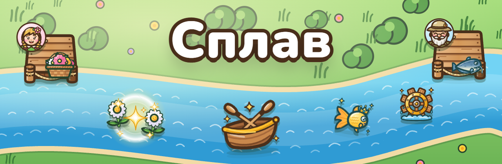
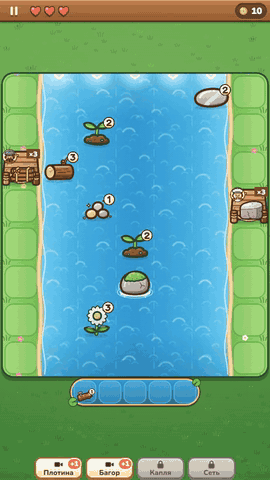
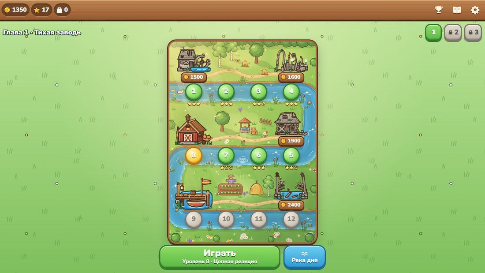
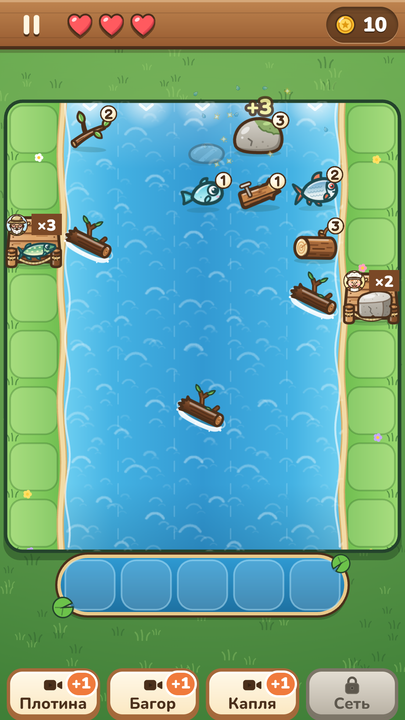
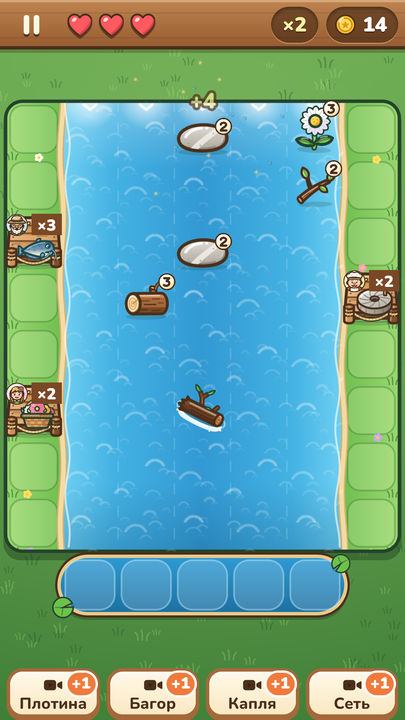
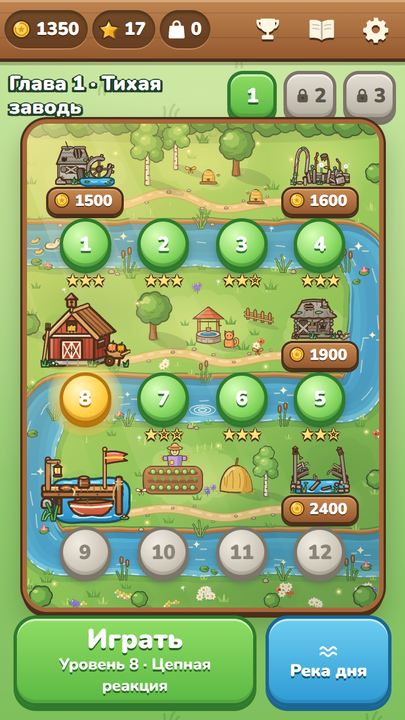
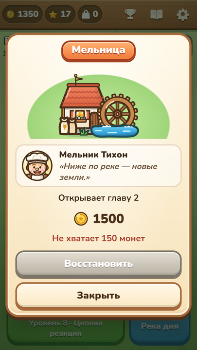

<p align="center">
  
</p>

<p align="center">
  <b>https://yandex.ru/games/app/637053?draft=true&lang=ru</b><br>
  <b>Merge-головоломка на реке для Яндекс Игр.</b><br>
  Река несёт брёвна, цветы, камни и рыбу — сливайте одинаковые, пока их не унесло, выполняйте заказы жителей и отстраивайте деревню.
</p>

<p align="center">
  <a href="https://github.com/GanJaGIT/splav/releases/latest"></a>
  
  
  
  
</p>

<table>
  <tr>
    <td width="40%" align="center"></td>
    <td>

### Что в игре

- **36 уровней в трёх главах** — «Тихая заводь», «Мельничный ручей», «Рыбачий плёс». Река сверху вниз сдвигает предметы на клетку, два одинаковых сливаются в предмет следующего уровня: щепка становится лодкой, семечко — венком, песчинка — мельничным колесом, малёк — золотой рыбкой.
- **Комбо, каскады и «Водоворот»** — быстрые слияния подряд дают больше монет, а новый предмет сам сливается с таким же соседом.
- **Шесть жителей** ждут заказы на пристанях. Уплывшее попадает в заводь, когда она полна — разбивается сердечко.
- **Деревня**: за монеты восстанавливаются пристань, сарай, мельница, цветник, баня и мост. Каждая постройка что-то даёт — новые главы, место в заводи, подарки, бонус к монетам.
- **Помощники** — Плотина, Багор, Волшебная капля и Сеть; энциклопедия находок, «Река дня» с рейтингом, «Спокойная река» для неспешной игры.
- Русский и английский, телефон и компьютер, прогресс в облаке.

</td>
  </tr>
</table>

## Скриншоты

<table>
  <tr>
    <td colspan="4"></td>
  </tr>
  <tr>
    <td align="center"></td>
    <td align="center"></td>
    <td align="center"></td>
    <td align="center"></td>
  </tr>
</table>

## Как играть

Цель уровня — выполнить все заказы на пристанях. Зелёные клетки по краям — берег: там ничего не плывёт, туда можно отложить нужное про запас.

| | Телефон | Компьютер |
|---|---|---|
| Слить предметы | протянуть предмет пальцем на такой же | перетащить мышью |
| Без перетаскивания | коснуться предмета, затем цели | щёлкнуть предмет, затем цель |
| Отдать заказ, отложить | протянуть на пристань, берег или в заводь | то же мышью |
| Помощники | кнопки внизу | кнопки сбоку или 1–4 |
| Пауза | ⏸ | ⏸, Escape или P |

## Запуск

Нужен [Node.js](https://nodejs.org) 24 LTS.

```bash
npm install
npm run dev
```

Игра откроется на http://localhost:5173. Вне Яндекс Игр работает локальная платформа: реклама — заглушки с кнопками «Досмотреть» и «Закрыть», сохранения — в браузере. Параметры адреса: `?lang=en` — язык, `?dev=1` — панель разработчика (выбор уровня, боты), `?level=c2-05` — сразу уровень, `?iap=1` — магазин, `?date=2026-10-22` — дата для «Реки дня».

| Команда | Что делает |
|---|---|
| `npm run dev` | игра с горячей перезагрузкой |
| `npm run verify` | всё сразу: типы, линтер, unit-тесты, все 36 уровней ботами, сборка, архив, его проверка, e2e |
| `npm run e2e` | Playwright: Chromium, Firefox, WebKit и мобильный WebKit, вёрстка на 10 размерах экрана × 2 языка, замер загрузки |
| `npm run sim -- c2-05 --bot all --seeds 20` | прогнать уровень ботами-новичком, обычным и ловким: победы, потери, длительность, монеты, комбо |
| `npm run balance` | сводка баланса всех уровней и экономики деревни → `docs/balance.md` |
| `npm run bench` | скорость симуляции |
| `npm run art` | SVG из `art/` → атлас PNG и контактные листы |
| `npm run promo` | иконка, обложки, скриншоты и видео для витрины, проверка текстов черновика; `--only=media` — картинки этого README |
| `npm run zip`, `npm run check:build` | архив для консоли Яндекс Игр и его проверка |
| `npm run dev:yg` | релизная сборка на моке SDK Яндекса (`@yandex-games/sdk-dev-proxy`) |

## Как устроено

```
src/
  sim/        симуляция реки — чистый TypeScript: ни Phaser, ни DOM, ни Math.random
  game/       Phaser 4 рисует поле: река, предметы, пристани, частицы
  ui/         интерфейс и деревня — DOM, CSS и SVG поверх поля
  services/   сохранения, звук, реклама, прогресс, рейтинги, магазин, «Река дня»
  platform/   единственное место с SDK Яндекс Игр (и локальная платформа для разработки)
  content/    цепочки, постройки, бустеры, шаблон «Реки дня» — JSON
  i18n/       тексты ru и en
levels/       36 уровней в JSON
art/          вся графика в SVG: предметы, жители, карта деревни, постройки, иконки
scripts/      атлас, промо, симуляция, баланс, проверки сборки
tests/        unit, уровни и e2e
docs/         ТЗ, журнал работы, тексты витрины, картинки README
```

- **Детерминированная симуляция.** Река живёт тиками по 100 мс, случайность — генератор mulberry32 в состоянии. Один и тот же уровень с тем же сидом и теми же действиями всегда даёт тот же результат; инварианты (ни один предмет не пропадает и не появляется сам) проверяются в тестах. Интерфейс, бот и тесты меняют игру только действиями.
- **Каждый уровень проверен ботами.** Три бота с темпом новичка, обычного и ловкого игрока проходят каждый уровень на 20 сидах без бустеров. Уровень, который бот не проходит, не коммитится; длительность, потери и поток предметов проверяются по нормам ТЗ.
- **Графика и звук без чужих ассетов.** 44 спрайта поля, карта деревни и 12 рисунков построек, 16 иконок — SVG, нарисованные для игры; спрайты собираются в атлас (`@resvg/resvg-js`), фон реки рисуется Canvas 2D. Звуки — маримба, колокольчики, вода — синтезируются Web Audio прямо в браузере. Из внешнего — только шрифт Nunito.
- **Требования Яндекс Игр — в тестах.** `LoadingAPI.ready()` — ровно один раз, через 2,4 с при замедлении процессора в 4 раза. Река стоит, а звук молчит при сворачивании вкладки, потере фокуса, паузе платформы и во время рекламы; если игрок ушёл во время ролика, после него открыта «Пауза». Полноэкранная реклама — только после «Дальше» или «В деревню» с 6-го уровня, не чаще раза в 3 минуты. Клавиатура — по `event.code`, нет контекстного меню и прокрутки страницы. Архив проверяется на внешние ссылки и отладочный код.
- **Витрина из кода.** Иконка и обложки собираются из SVG игры, скриншоты и видео снимаются с играющим ботом для каждого языка, MP4 — через ffmpeg.

## Как сделана

Игру по шагам написал [Claude Code](https://claude.com/claude-code) по заданию автора, по этапам техзадания: каркас, симуляция и бот, поле и интерфейс, уровни и деревня, SDK и монетизация, полировка и релиз. Всё лежит в репозитории:

- [`docs/TZ.md`](docs/TZ.md) — техническое задание;
- [`docs/PROGRESS.md`](docs/PROGRESS.md) — журнал: что сделано, какие решения приняты и почему;
- [`docs/store/`](docs/store) — тексты черновика для витрины и пошаговая загрузка в консоль;
- [`CLAUDE.md`](CLAUDE.md) — правила проекта, [`START.md`](START.md) — как вести проект через Claude Code;
- [`.claude/`](.claude) — навыки `/level-design`, `/yg-audit`, `/yg-release` и агент `yg-moderator`, который проверяет игру «глазами модератора» перед отправкой.

## Релизы

В [релизах](https://github.com/GanJaGIT/splav/releases) лежат архив для консоли Яндекс Игр и видео игрового процесса на русском и английском. Архив рассчитан на SDK Яндекса и сам по себе не запускается. Поиграть локально — `npm run dev`.

## Материалы и лицензия

Шрифт Nunito — SIL Open Font License 1.1, движок Phaser — MIT; их лицензии лежат в архиве игры (`licenses.txt`). Подробности — в [`CREDITS.md`](CREDITS.md). Лицензия на код игры не выбрана: исходники открыты для чтения, все права у автора.

---

### In English

**Merge River** (*Сплав*) is a merge puzzle for Yandex Games. The river carries logs, flowers, stones and fish down the field; you merge matching items before the current takes them away, fill the villagers' orders on the piers and rebuild their village. It has 36 levels in three chapters, four chains of six steps, combos and cascades, six villagers and six buildings to restore, four helpers, an encyclopedia, a daily river with a leaderboard and a calm mode. The game supports Russian and English, phones and desktops.

It is built with TypeScript, Phaser 4 and Vite, on top of a deterministic river simulation in plain TypeScript; every level is checked by three bots on 20 seeds. All the art is SVG made for the game, and the sounds are synthesized in the browser. Run it with `npm install && npm run dev`. The game was written by Claude Code from the specification in `docs/TZ.md`; the log of the work is in `docs/PROGRESS.md`.
